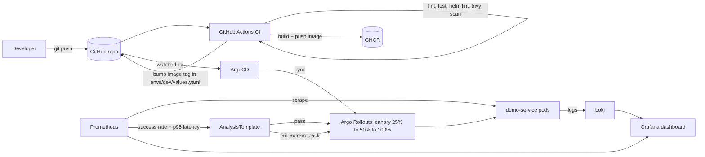

# Safe Delivery Platform

A portfolio DevOps/SRE project: a developer runs `git push`, and everything
else — build, scan, GitOps sync, progressive canary delivery with automatic
rollback, and observability — happens on its own, on a local `kind` cluster.

## Overview

1. GitHub Actions: lint, unit tests, Helm lint, Trivy scan, build + push the
   image to GHCR.
2. CI only updates the image tag in Git (`envs/dev/values.yaml`) — it never
   touches the cluster directly.
3. ArgoCD watches Git and syncs the Helm chart onto the `kind` cluster.
4. Argo Rollouts ships the new version gradually: canary at 25% → 50% → 100%.
5. At every canary step, Prometheus is queried for success rate and p95
   latency (via an `AnalysisTemplate`, scoped to the canary pods only). If
   the new version is unhealthy, the rollout aborts automatically and
   traffic stays on the last-good version.
6. Every service built from the `golden-path-service` Helm chart gets
   metrics, logs (Loki) and a Grafana dashboard for free — no extra work per
   service.

## Architecture



## Repository layout

| Path | Purpose |
|---|---|
| `app/` | FastAPI demo service, tests |
| `Dockerfile` | Non-root container image for the demo service |
| `.github/workflows/ci.yml` | Lint, test, Helm lint, build/scan/push, bump tag |
| `charts/golden-path-service/` | Golden-path Helm chart (Rollout, Service, ServiceMonitor, AnalysisTemplate, load generator, Grafana dashboard) |
| `envs/dev/values.yaml` | Environment-specific overrides CI updates on every push |
| `argocd/application.yaml` | ArgoCD Application pointing at this repo |
| `monitoring/` | Helm values for kube-prometheus-stack and loki-stack |
| `scripts/` | `setup.sh`, `demo-good-release.sh`, `demo-bad-release.sh`, `teardown.sh`, `kind-config.yaml` |

## Prerequisites

- Docker Desktop (with WSL2 integration if on Windows)
- `kind`, `kubectl`, `helm`, `git` on PATH
- A GitHub account (for CI/CD and GHCR)

## Setup

1. Create a GitHub repo named `safe-delivery-platform` (or any name) and
   push this project to it.
2. Already done for you: image repo / ArgoCD source point at `harpree763/devops_pipeline`.
3. After the first CI run pushes an image, make the GHCR package **Public**
   (GitHub profile → Packages → safe-delivery-platform → Package settings →
   Change visibility), otherwise `kind` will hit `ImagePullBackOff`.
4. Run:
   ```bash
   ./scripts/setup.sh
   ```

## Demo

```bash
# 1. Ship a good release — canary should go 25% -> 50% -> 100% -> Healthy
./scripts/demo-good-release.sh v2

# 2. Ship a deliberately bad release — AnalysisRun should fail and the
#    rollout should auto-abort, with stable pods still serving traffic
./scripts/demo-bad-release.sh

# 3. Recover — ship a good release again
./scripts/demo-good-release.sh v4
```

## Design decisions

- **GitOps (ArgoCD), not `kubectl apply` from CI.** CI never has direct
  cluster credentials; it only changes a file in Git. This keeps the blast
  radius of a compromised CI token limited to "can open a commit," not
  "can modify the cluster directly."
- **Analysis queries are scoped to canary pods only**, via the
  `rollouts-pod-template-hash` label (exposed through `ServiceMonitor.
  podTargetLabels`). Without this, Prometheus would average metrics across
  both old and new pods, masking a regression in the new version.
- **Two signals (success rate + p95 latency), not one.** A new version can
  fail by erroring out *or* by getting slow without erroring; checking both
  catches more classes of bad release.
- **Observability is part of the chart, not a separate step.** Every
  service built from `golden-path-service` ships with a `ServiceMonitor`
  and a Grafana dashboard automatically (via the chart defaults), so
  observability can't be "forgotten" per service.

## Known limitations / next steps

- Single-cluster, single-environment (`dev`) demo; `envs/` is structured to
  add `staging`/`prod` overlays later.
- The load generator is for demo purposes only (keeps `/work` traffic
  flowing so the AnalysisTemplate always has data) — remove
  `loadGenerator.enabled` in a real deployment with real traffic.
- No mTLS/service mesh; Argo Rollouts' traffic shifting here is pod-weight
  based (no dedicated traffic-management layer like Istio/SMI).
- Optional Terraform phase (EKS/GKE module, remote state, `plan`-only CI)
  is scaffolded separately — see `terraform/` if present.
